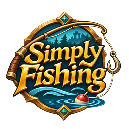

# Simply Fishing

**One-key fishing and interaction for WoW Forever**

Simply Fishing uses one configurable key to cast your line, interact with the fishing bobber, and interact normally when you have another weapon equipped.

## Features

- Shared fishing and interaction key
- Configurable keyboard and native controller bindings, including supported modifiers
- Fast Loot for fishing catches
- Toggle for WoW's native Auto Loot
- In-game options panel with the Simply Fishing icon
- Quiet startup and saved preferences

## Installation

Download the release package from CurseForge and extract the `SimplyFishing` folder into your WoW Forever `Interface/AddOns` directory. Reload the game or restart the client.

## Settings

Open **Esc → Options → AddOns → Simply Fishing**, or use `/sfish options`.

The `/sfish bind F` command assigns an example key; replace `F` with the key you want. Mouse bindings are disabled in v1.1.0 because of a known interaction with the game's Ping control.

## Artwork

`SimplyFishingIcon.tga` is the in-game addon texture. `SimplyFishingIcon.png` is a GitHub-friendly preview of the same icon.

## Compatibility

Built for **WoW Forever**, interface version **16001**.
